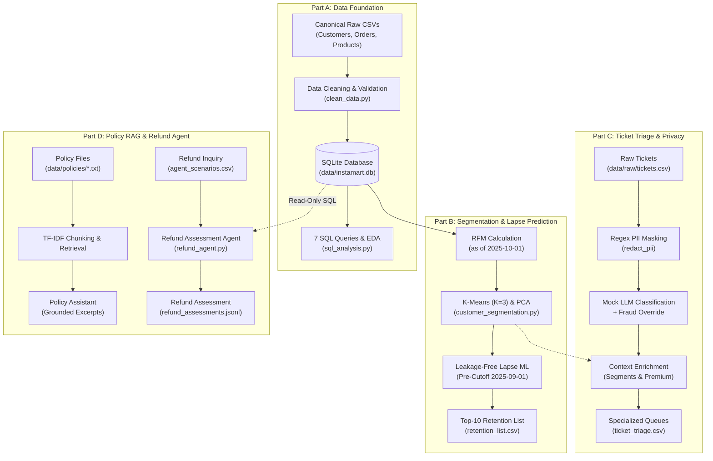

# Instamart Customer Intelligence & Support Copilot

## 1. Project Overview & Business Problem

The **Instamart Customer Intelligence & Support Copilot** implements an end-to-end customer analytics and support intelligence pipeline for quick-commerce and retail operations. In high-velocity retail environments, business teams must balance three critical challenges:

1. **Data Trust & Transaction Reconciliation**: Auditing messy raw transactional data, reconciling multi-city catalog orders, enforcing chronological validity, and establishing a single source of truth in SQLite.
2. **Customer Retention & Lapse Intervention**: Computing RFM (Recency, Frequency, Monetary) metrics, discovering behavioral clusters, and predicting customer lapse before churn occurs.
3. **Privacy-Safe Customer Support Triage**: Ingesting incoming customer support inquiries, redacting personal identifying information (PII) before LLM exposure, and safely routing tickets to specialized support desks.
4. **Policy-Grounded Refund Guidance**: Assessing refund eligibility against published store policies using read-only SQL queries and retrieval-augmented citations without fabricating facts or authorizing unverified payouts.

The system is designed for complete local reproducibility, using synthetic transactional datasets and a local deterministic mock LLM simulation (`mock_llm.py`), eliminating external network API dependencies and costs.

---

## 2. Features & Architecture

The project consists of four decoupled modules:



> [!NOTE]
> **Component Separation:** Part C (ticket triage) and Part D (refund agent) operate independently. Part D evaluates standalone scenario inquiries and does not consume Part C triaged ticket context; ticket-context integration is not implemented.

---

## 3. Technology Stack

- **Language & Runtime:** Python 3.11+ (tested on Python 3.14.2)
- **Data Engineering:** pandas, NumPy
- **Machine Learning & Modeling:** scikit-learn (KMeans, PCA, LogisticRegression, RandomForestClassifier, StandardScaler, OneHotEncoder), joblib
- **Database:** SQLite 3 (accessed via Python standard library `sqlite3` in read-only URI mode)
- **NLP & Retrieval:** TF-IDF (`TfidfVectorizer`), Cosine Similarity (`cosine_similarity`)
- **LLM Simulation:** Offline deterministic keyword-matching module (`mock_llm.py`)
- **Testing:** Python standard library `unittest`

---

## 4. Repository Structure

```
Instamart-Customer-Intelligence-Copilot/
├── .gitignore                          # Protected ignore rules for venv, env files, and temporary buffers
├── README.md                           # Master project documentation
├── requirements.txt                    # Pinned Python package dependencies
├── run_project.py                      # Full pipeline orchestrator (Parts A, B, C, D)
├── generate_data.py                    # Deterministic date transformation script for raw records
├── mock_llm.py                         # Offline simulated LLM module (keyword-based)
├── archive/
│   └── part_b_final/                   # Immutable preservation archive of Part B models and outputs
│       ├── README.md                   # Archive provenance and contents explanation
│       ├── SHA256SUMS.txt              # Cryptographic checksum manifest for all 18 archived files
│       ├── outputs/                    # Preserved Part B outputs, models, and diagnostic reports
│       └── src/part_b/                 # Preserved Part B source code
├── data/
│   ├── clean/                          # Cleaned CSV files produced by Part A
│   │   ├── customers.csv               # 1,200 cleaned customer profiles
│   │   ├── orders.csv                  # 12,309 cleaned and deduplicated order records
│   │   └── products.csv                # 40 catalogue products
│   ├── policies/                       # Policy text corpus used by Part D
│   │   ├── assignment_rules.txt        # 11 assignment rules (refunds, delivery, escalations)
│   │   ├── delivery_policy.txt         # Delivery SLA policies
│   │   ├── escalation_policy.txt       # Customer escalation guidelines
│   │   ├── payment_policy.txt          # Payment and refund routing policies
│   │   ├── privacy_policy.txt          # Data privacy constraints
│   │   └── refund_policy.txt           # Standard return and refund rules
│   ├── raw/                            # Tracked raw source datasets
│   │   ├── agent_scenarios.csv         # 7 refund assessment scenarios (S1-S7)
│   │   ├── customers.csv               # 1,200 raw customer records
│   │   ├── orders.csv                  # 13,084 raw orders (including duplicates)
│   │   ├── policy_eval.csv             # 15 evaluation queries for policy retrieval
│   │   ├── products.csv                # 40 catalogue products
│   │   └── tickets.csv                 # 164 support tickets
│   └── instamart.db                    # Authoritative SQLite database built by Part A
├── outputs/                            # Validated output deliverables
│   ├── customer_segment_profiles.csv   # Cluster profile summary metrics
│   ├── customer_segments.csv           # Customer RFM and assigned cluster labels
│   ├── data_preservation_report.json   # Machine-readable Part A data preservation evidence
│   ├── lapse_forest_model.joblib       # Trained random forest classifier
│   ├── lapse_model.joblib              # Trained baseline logistic regression model
│   ├── lapse_model_diagnostics.json    # CV and test confusion matrices and diagnostics
│   ├── lapse_oversampled_logistic_model.joblib # Oversampled logistic model
│   ├── lapse_test_predictions.csv      # Test cohort predictions and lapse probabilities
│   ├── part_b_final_report.md          # Comprehensive Part B ML evaluation report
│   ├── privacy_masking_report.json     # PII redaction audit counts
│   ├── refund_assessments.jsonl        # Output assessments from refund agent
│   ├── retention_list.csv              # Top-10 premium retention intervention list
│   ├── rfm_analysis.csv                # Individual customer RFM metrics
│   ├── rfm_kmeans_metrics.csv          # Silhouette and inertia scores across K=2..8
│   ├── rfm_pca_explained_variance.csv  # 2D PCA explained variance breakdown
│   ├── ticket_quality_report.json      # Ticket data quality audit
│   ├── ticket_routing_report.json      # Ticket routing distribution report
│   ├── ticket_triage.csv               # Triaged tickets with masked text and queue assignments
│   ├── triage_results.csv              # [Historical] Legacy prototype output from initial commit
│   ├── triage_budget_demo.csv          # [Historical] Legacy budget exhaustion test artifact
│   ├── agent_runs.jsonl                # [Historical] Prototype multi-step agent execution log
│   └── refund_ledger.jsonl             # [Historical] Prototype simulated ledger transaction log
├── reports/                            # Governance, hygiene, and audit reports
│   ├── final_project_completion_report.md # Master GitHub release readiness and QA audit
│   ├── final_repository_hygiene_audit.md  # Repository hygiene, license, and baseline report
│   └── ticket_contact_provenance_and_sanitization.md # Provenance audit and proposed sanitization plan
├── sql/
│   └── queries.sql                     # Analytical SQL queries Q1 through Q7
├── src/
│   ├── config.py                       # Root project paths and configurations
│   ├── part_a/                         # Data foundation and SQLite pipeline
│   │   ├── clean_data.py               # Cleaning and DB loading pipeline
│   │   ├── data_audit.py               # Raw dataset auditing logic
│   │   ├── database.py                 # SQLite connection utilities
│   │   ├── sql_analysis.py             # Query execution and Pandas pivot reconciliation
│   │   └── validation.py               # 19 validation checkpoints
│   ├── part_b/                         # Customer segmentation and lapse prediction
│   │   ├── customer_segmentation.py    # RFM, K-Means (K=3), and PCA
│   │   ├── lapse_prediction.py         # Leakage-free cohort ML modeling
│   │   ├── retention.py                # Top-10 retention list builder
│   │   └── rfm_analysis.py             # RFM calculation routines
│   ├── part_c/                         # Support ticket triage and privacy
│   │   ├── classifier.py               # Mock LLM classifier with deterministic fraud guardrail
│   │   ├── privacy.py                  # Regex PII redactor (emails, phones, order IDs)
│   │   ├── prompts.py                  # LLM prompt templates
│   │   └── ticket_routing.py           # Triage pipeline, segment enrichment, and queue routing
│   └── part_d/                         # Policy RAG and refund evaluation
│       ├── checkpoint.py               # State tracking utilities
│       ├── policy_assistant.py         # Standalone console policy assistant
│       ├── policy_retrieval.py         # TF-IDF chunking, search, and citation validator
│       ├── refund_agent.py             # Read-only refund assessment agent
│       └── refund_tools.py             # Parameterized SQL query tools
└── tests/
    ├── test_part_c.py                  # 17 automated unit tests for Part C
    └── test_part_d.py                  # 18 automated unit tests for Part D
```

---

## 5. Installation & Setup

### Requirements
- **Operating System:** Windows, macOS, or Linux
- **Python:** Version 3.11 or newer (tested on Python 3.14.2)
- **SQLite:** Standard library `sqlite3` (no external SQLite server installation required)

### Environment Setup

From a terminal in the repository root directory:

```powershell
# 1. Create a virtual environment
python -m venv venv

# 2. Activate the virtual environment
# On Windows PowerShell:
venv\Scripts\Activate.ps1
# On Linux / macOS:
source venv/bin/activate

# 3. Install pinned dependencies
python -m pip install -r requirements.txt
```

---

## 6. Execution Instructions

Choose **one** execution route depending on your workflow. Do not run the full pipeline and then repeat all component commands.

### Route 1: Full Pipeline (Rebuild Data, Database, Models & Outputs)
`run_project.py` executes Parts A, B, C, and D in sequence. It cleans raw data, recreates `data/instamart.db`, trains Part B models, writes `outputs/`, runs Part C ticket triage, and writes Part D refund assessments. It does not run `generate_data.py` or the standalone policy assistant.

```powershell
python generate_data.py
python run_project.py
```

### Route 2: Individual Component Execution (Targeted Runs)
Use these commands when inspecting or executing a specific part:

- **Part A (Data Foundation & Database Rebuild)**:
  Cleans raw CSVs, creates `data/instamart.db`, and executes all 19 validation checkpoints:
  ```powershell
  python -m src.part_a.clean_data
  ```
- **Part A (SQL Analytics & EDA)**:
  Runs the 7 analytical queries in `sql/queries.sql` and cross-checks revenue with a Pandas pivot:
  ```powershell
  python -m src.part_a.sql_analysis
  ```
- **Part B (Segmentation & Lapse ML)**:
  Computes RFM metrics, fits K-Means ($K=3$), runs 2D PCA, trains lapse models (Logistic, Random Forest, Oversampled), and writes retention outreach lists:
  ```powershell
  python -m src.part_b.customer_segmentation
  ```
- **Part C (Support Ticket Triage)**:
  Redacts PII, triages tickets with `mock_llm.py` and safety overrides, enriches records with customer segments, and generates audit reports:
  ```powershell
  python -m src.part_c.ticket_routing
  ```
- **Part D (Refund Assessment Agent)**:
  Evaluates sample refund scenarios against policy rules and read-only order lookups, generating `outputs/refund_assessments.jsonl`:
  ```powershell
  python -m src.part_d.refund_agent
  ```

### Route 3: Standalone Demonstrations & Safe Verification
- **Standalone Policy Assistant**:
  Demonstrates grounded lexical retrieval answering policy questions with exact citations:
  ```powershell
  python -m src.part_d.policy_assistant
  ```
- **Safe Automated Unit Testing (Read-Only)**:
  Executes all 35 unit tests for Part C and Part D safely without modifying databases or overwriting outputs:
  ```powershell
  python -m unittest discover -s tests -p "test_*.py" -v
  ```

---

## 7. Part A — Data Foundation & Analytics Layer

Part A audits the canonical tracked CSVs, cleans them, builds SQLite tables, runs seven SQL queries, and cross-checks completed revenue with a Pandas pivot.

### Observed Raw Data Audit

| File | Rows | Columns | Observations |
|---|---:|---:|---|
| `customers.csv` | 1,200 | 5 | 20 blank ages, 3 ages outside 10–100, 30 blank genders, 7 city spelling variants. |
| `products.csv` | 40 | 4 | Complete catalogue; prices range from INR 1,453.67 to INR 2,935.15. |
| `orders.csv` | 13,084 | 9 | 656 exact duplicate rows, 119 repeated order IDs after deduplication, 662 pending orders. 12,308 blank amounts, 776 invalid nonblank amounts, 106 negative delivery values, 12,978 blank delivery values. |
| `tickets.csv` | 164 | 5 | 4 ground-truth categories (41 each). 14 empty messages. Contact-shaped patterns in 22 rows. |

### Cleaning & Validation
- **Preservation of Business Records:** `generate_data.py` adjusts only `orders.order_ts` (mapped to `2025-04-01` through `2025-09-30`) and `customers.signup_date` (mapped to `2024-04-04` through `2025-08-02`, preceding first non-pending orders). All customer attributes, product prices, order amounts, and quantities are preserved.
- **Cleaned Dimensions:**
  - Customers: 1,200 rows. Cities: Pune 218, Delhi 204, Bengaluru 201, Mumbai 201, Chennai 197, Hyderabad 179. Genders: female 594, male 547, unknown 59. Ages: imputed within $[18, 60]$.
  - Orders: 12,309 unique IDs: completed 11,430, pending 662, cancelled 217.
  - Completed Revenue: **INR 41,822,667.48**.
  - Missing Delivery Times: Raw data contains zero usable completed-order delivery times (12,978 blank, 106 negative); all 11,430 completed delivery values are correctly left missing rather than fabricated.
- **SQLite Database:** Rebuilt `data/instamart.db` passes all 19 Part A validation checkpoints.

### SQL & Pandas Reconciliation

| Query | Actual Result | Assignment Reference | Status & Evidence |
|---|---|---|---|
| **Q1 (Completed spend filter)** | 1,184 customers | 30 | Preserved source records yield 1,184 qualifying customers. |
| **Q2 (Revenue by city/category)** | 24 combinations; INR 41,822,667.48 (Highest: Bengaluru / Home at INR 2,522,588.74) | 30 combinations | Current data contains 6 cities and 4 categories ($6 \times 4 = 24$). |
| **Q3 (Above-average products)** | 18 products | 11 | Preserved product catalogue has 18 items above mean catalogue price. |
| **Q4 (Customers without orders)** | 0 customers | 25 | Every customer in the cleaned dataset has at least one completed order. |
| **Q5 (Above-average spenders)** | 566 customers (mean spend INR 34,852.22) | 550 | Follows current query and preserved spend data. |
| **Q6 (City spend ranks)** | 1,200 rows (0 RANK vs ROW_NUMBER ties) | 8 differences | Preserved spend values produce distinct ranks without ties. |
| **Q7 (Running daily revenue)** | 183 daily rows; final cumulative INR 41,822,667.48 | 183 days | Day count matches exactly; cumulative revenue reflects actual data. |

Pandas `pivot_table(..., margins=True)` grand total matches SQL Q2 at exactly **INR 41,822,667.48**.

---

## 8. Part B — RFM Segmentation & Lapse Prediction

The results below are the **authoritative measured results** produced on the corrected SQLite database. `archive/part_b_final/` preserves the validated Part B source and output files, sealed by `SHA256SUMS.txt`.

### RFM & Clustering Summary
RFM is evaluated as of `2025-10-01` across 1,200 customers:
- **Recency (days):** Median 13, Min 0, Max 134.
- **Frequency (orders):** Mean 9.525, Max 20.
- **Monetary (INR):** Mean INR 34,852.22, Max INR 98,372.83.

K-Means clustering was evaluated across $K=2..8$ using standardized RFM features (`n_init=10`, `random_state=42`). **$K=3$** was chosen based on the highest silhouette score (0.3497) and actionable profile separation:

| Segment | Customers | Mean Recency | Mean Frequency | Mean Monetary | Premium Count | Strategic Action |
|---|---:|---:|---:|---:|---:|---|
| **Steady Shoppers** | 581 | 12.68 days | 8.05 | INR 27,134.10 | 0 | Encourage cross-sells and regular repeat orders |
| **At-Risk Shoppers** | 178 | 52.18 days | 7.04 | INR 25,042.51 | 0 | Deploy win-back campaigns and investigate churn causes |
| **High-Value Regulars** | 441 | 12.24 days | 12.47 | INR 48,980.02 | 145 | Reward loyalty and protect with dedicated premium support |

PCA reduces the 3 standardized RFM features to 2 principal components explaining **92.06%** of total variance (PC1: 63.51%, PC2: 28.55%).

### Lapse Prediction & Modeling
- **Cohort & Cutoff:** 1,198 eligible customers with at least one completed order prior to `2025-09-01`.
- **Target Label:** Active if $\ge 1$ completed order occurred in $[2025\text{-}09\text{-}01, 2025\text{-}10\text{-}01)$; Lapsed otherwise. Active: 949 (79.22%), Lapsed: 249 (20.78%).
- **Leakage Prevention:** Features aggregate order records strictly before `2025-09-01`. All transformers fit inside training folds via scikit-learn `Pipeline`.
- **Split:** Stratified 80/20 train/test split (958 train / 240 test).

| Model | Test Accuracy | Precision | Recall | F1 Score | Specificity | False Positive Rate |
|---|---:|---:|---:|---:|---:|---:|
| **Most-Frequent Baseline** | 0.792 | 0.000 | 0.000 | 0.000 | 1.000 | 0.000 |
| **Logistic Regression (C=0.01)** | 0.792 | 0.000 | 0.000 | 0.000 | 1.000 | 0.000 |
| **Random Forest (depth=3, leaf=5)** | 0.792 | 0.000 | 0.000 | 0.000 | 1.000 | 0.000 |
| **Oversampled Logistic Regression** | 0.542 | 0.237 | 0.540 | 0.329 | 0.542 | 0.458 |

**Insight:** Baseline, Logistic Regression, and Random Forest achieve 79.2% accuracy by predicting all customers active, detecting zero lapsed customers. Training-only oversampling balances training classes from 759/199 to 759/759, raising lapse recall from 0.000 to 0.540 (detecting 27 of 50 test lapsed customers).

`outputs/retention_list.csv` contains the top-10 premium test customers prioritized for retention outreach.

---

## 9. Part C — Support Ticket Triage with Privacy & Safety Guardrails

Part C validates and triages the synthetic records in `data/raw/tickets.csv` using the offline `mock_llm.py` and strict regex PII masking:

- **Data Quality:** 164 total records audited: 0 duplicate rows, 0 duplicate ticket IDs, 14 empty messages (retained and routed to `Human Support Lead`), 0 messages exceeding 400 tokens.
- **PII Redaction:** Masking covers email addresses (`[EMAIL]`), Indian and international mobile numbers (`[PHONE]`), and order IDs (`[ORDER_ID]`). Detected across 22 affected rows; masked prior to LLM exposure and output generation.
- **Classification & Guardrails:** Only masked text is sent to `mock_llm.chat`. A deterministic fraud safety override routes explicit security/unauthorized purchase wording to `Fraud/Security Team`.
- **Enrichment:** Tickets are enriched with Part B customer segment and premium status. Missing lapse predictions remain unknown (0/164 coverage).
- **Queue Allocations:**
  - `Billing Support`: 49
  - `Technical Support`: 34
  - `Fraud/Security Team`: 34
  - `Delivery Support`: 33
  - `Human Support Lead`: 14 (empty messages)
- **Automated Tests:** All 17 Part C unit tests pass.

---

## 10. Part D — Policy RAG & Refund Assessment Agent

Part D implements local lexical retrieval and a read-only refund assessment engine:

- **Policy Retrieval:** Policy text files in `data/policies/` are chunked and indexed via TF-IDF. The assistant extracts exact source excerpts and validates grounding against retrieved chunks.
- **Read-Only SQL Safety:** Order queries use parameterized SQL on read-only SQLite connections, requiring both `order_id` and verified matching `customer_id`. Default orders are never assumed.
- **Refund Policy Rules:**
  - Completed orders with delivery delay $>45$ minutes are eligible for refund.
  - Cancelled or pending orders are not refundable.
  - Requests outside the 7-day completion window are denied.
  - Large refunds ($> \text{INR } 1,000$) require human approval.
  - Handoff recommendations are flagged after 6 support turns or for fraud indicators.
- **Assessment Safeguards:** The engine outputs assessment recommendations to `outputs/refund_assessments.jsonl` (`REFUND_ELIGIBLE_NOT_EXECUTED`, `CUSTOMER_VERIFICATION_REQUIRED`, `NEEDS_REVIEW`). It does not execute refunds, mutate financial ledgers, or send external notifications.
- **Automated Tests:** All 18 Part D unit tests pass.

---

## 11. Legacy and Archival Artifacts

| File | Classification | Status & Operational Role |
|---|---|---|
| `outputs/triage_results.csv` | Historical / Superseded | Early prototype output from initial commit (`e7f1eea`). Superseded by `outputs/ticket_triage.csv`. |
| `outputs/triage_budget_demo.csv` | Historical / Example | Test file demonstrating token budget exhaustion. Superseded by current error routing. |
| `outputs/agent_runs.jsonl` | Historical / Simulated | Multi-turn prototype agent execution log. Preserved for auditability; not live interactions. |
| `outputs/refund_ledger.jsonl` | Historical / Simulated | Simulated prototype ledger entries. Preserved for auditability; no real payouts occurred. |
| `archive/part_b_final/` | Authoritative Preservation Archive | Immutable snapshot of Part B source code and outputs from the corrected SQLite database. Sealed by `SHA256SUMS.txt`. |

---

## 12. Limitations & Known Issues

1. **No Usable Completed-Delivery Measurements:** All 12,978 blank and 106 negative raw delivery times leave zero valid completed measurements in the source data. Delivery-time correlations are unavailable, and delivery delay refund claims evaluate to `NEEDS_REVIEW`.
2. **Lapse Prediction Coverage:** Retention list outreach is restricted to the top-10 premium test cohort. Missing predictions are left unknown, resulting in 0/164 coverage for the current support ticket cohort.
3. **Component Separation:** Part C (ticket triage) and Part D (refund agent) operate independently. Part D does not consume Part C enriched tickets.
4. **Unverified Ticket-Contact Provenance:** Contact-shaped strings (email addresses, phone numbers) in `data/raw/tickets.csv` have unverified exact provenance. They are masked before model processing. See `reports/ticket_contact_provenance_and_sanitization.md`.
5. **Stateless Handoff Evaluation:** The policy's 6-step human handoff trigger is evaluated as an individual state threshold; full multi-turn conversational session tracking is not implemented.
6. **Local Simulation:** All LLM capabilities are simulated locally via `mock_llm.py` without external network API calls.
